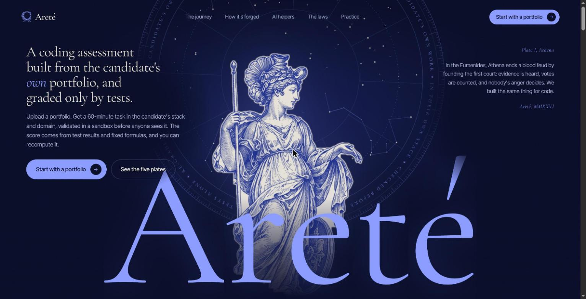

# Areté

**Portfolio-Driven Adaptive Coding & Technical Assessment Platform**

Areté turns a candidate's own record (résumé, GitHub, LeetCode and Codeforces) into a
validated 60-minute coding assessment in their own domain and tech stack. Tests decide
correctness, never a language model, and the candidate's code runs only in locked-down
sandboxes.



## Why

Generic coding tests ignore what a candidate has actually built, and AI coding tools
make it hard to tell whether someone understands the work in their portfolio. A
LeetCode medium says little about whether a person can find a bug in a FastAPI service.
Areté builds the test from the candidate's portfolio instead: their stack, their
domain, the concepts they claim and the DSA topics they have solved.

## How it works

1. **Profile.** The portfolio becomes a profile (domain, runtime, concepts, tier) by
   plain rules. A small model is called once, only when the rules can't place it.
2. **Build.** Two tasks are built from tested seed repos and a DSA bank of about 100
   problems:
   - **Novice:** a one-file bug, injected by a LibCST mutation engine and kept only if
     it breaks some tests, plus an easy DSA problem.
   - **Adept:** a feature stubbed out across 2-3 files, plus a medium DSA problem.
   - **Master:** a multi-file bug with a performance constraint, plus a medium or hard
     DSA problem.
3. **Gate.** Every task passes a validation gate before release: the reference
   solution passes, the starter fails, and the statement doesn't leak the answer. Each
   task gets a certificate.
4. **Assess.** The candidate works in a browser IDE (bundled Monaco) with Run and
   Submit. Code runs in fresh Docker containers with no network, CPU, memory, PID and
   time limits, and a non-root user. Hidden tests run in their own sandbox.
5. **Assist.** On Adept and Master, a guarded hint assistant gives graded hints, never
   solutions. Using it efficiently counts for up to 20% of the score.
6. **Report.** A deterministic score and band from test results and fixed formulas
   (fail-to-pass, SWE-bench style). The same events and snapshots always give the same
   score, and the Re-grade button proves it. The report also shows claim verification,
   a progress timeline, hint ROI, integrity notes and a **Trail Map** replay of the
   candidate's path through the code. None of these affect the score.
7. **Interview.** An optional AI voice interviewer asks about the candidate's own
   submitted changes. It needs mic consent, stores transcripts (not audio) and never
   affects the score.

The candidate journey also includes **practice mode** (a LeetCode-style problem list
with a sandboxed IDE), the **Labyrinth** (code comprehension) and the **Oracle** (the
interview).

## Architecture

```
 Browser (Next.js)                 Backend (FastAPI)                     Sandboxes
 ─────────────────                 ─────────────────                     ─────────
 Landing, journey  ───/api──▶  routes ─ profiler ─ builder ─ gate
 Candidate IDE                  │          │                 │
 Report, Trail Map              │          ▼                 ▼
 Voice interview                │      backend/llm ──▶ Featherless (text + TTS)
                                │      (cache, budget, token log)
                                ▼
                         Celery workers ──────────────▶ Docker runner containers
                         (grading, auto-submit)          no network, resource limits
                                │
                     PostgreSQL 16 · Redis 7
```

| Layer | Tech |
| --- | --- |
| Backend | Python 3.11, FastAPI, Pydantic v2, SQLAlchemy 2 + Alembic, Celery + Redis, pytest |
| Task building | LibCST mutation and feature-removal engines, seed repos, DSA bank with Python and JS harnesses |
| LLM | OpenAI Python SDK against the Featherless API, wrapped with Instructor (JSON mode); model slots for generator, assistant, probe and interviewer; every response cached in Redis, with a hard spend cap |
| Speech | Featherless text-to-speech for the interviewer's voice; the browser Web Speech API for listening |
| Runner | Docker images per runtime (`runtimes/python311`, `runtimes/node20`) |
| Frontend | Next.js (App Router), TypeScript, Tailwind, Monaco, React Flow, assistant-ui, GSAP |
| Contracts | JSON Schemas in `contracts/` are the source of truth; Pydantic and TypeScript types are generated from them |
| Database | PostgreSQL 16 |

### Design rules

- Language models never decide correctness or scores.
- Reference solutions and hidden tests never leave the backend: not to the browser,
  not into any model's context, not in any API response.
- A run counts only if exactly the task's expected test IDs were collected, and the
  candidate can edit only starter files outside tests and config.
- Every model call sets `max_tokens` and a low temperature, is cached by input hash,
  and is logged with its token count.

## Getting started

Requirements: Docker with Compose, and GNU Make.

```bash
cp .env.example .env          # add FEATHERLESS_API_KEY for the AI features
make runtimes                 # build the sandbox images
make up                       # postgres, redis, api, worker, beat, frontend
make migrate                  # create the database tables
```

Then open:

- http://localhost:3000: the Areté landing page and candidate journey
- http://localhost:3000/practice: practice problems
- http://localhost:8000/docs: the API

To get a ready-made assessment session (the 60-minute timer starts immediately):

```bash
make seed-demo                # or: make seed-demo TIER=adept / TIER=master
```

It prints a session URL. Fix the bug, press Run, then Submit to see the report.

The demo flow needs no API key. The hint assistant, task enrichment and voice
interviewer need `FEATHERLESS_API_KEY`.

### Commands

| Command | What it does |
| --- | --- |
| `make up` / `make down` | Start or stop the stack |
| `make migrate` | Apply database migrations |
| `make seed-demo` | Build, validate and open a demo assessment |
| `make test` | Backend tests (pytest, in the api container) |
| `make test-docker` | Runner tests that start real sandbox containers |
| `make e2e` | Headless Chromium drives the full demo flow and checks the scores |
| `make lint` | Linters |
| `make contracts` | Regenerate Pydantic and TypeScript types from the schemas |
| `make mutate SEED=... CONCEPT=...` | List and validate bug candidates for a Novice task |
| `make remove-feature SEED=... [CONCEPT=...]` | Stub a concept and validate an Adept task |
| `make build-master` | Build a Master task with a performance constraint |
| `make gate` | Run the validation gate on a task |
| `make llm-smoke` / `make llm-usage` | Check each model slot; show token use and spend |

## Project structure

```
.
├── backend/      FastAPI app, profiler, task builders, gate, scoring, assistant,
│                 report, trail map, interviewer, LLM client, runner, tests
├── frontend/     Next.js app: landing and journey, candidate IDE, report, interview, practice
├── contracts/    JSON Schemas (source of truth), fixtures, generated types
├── seeds/        Hand-written seed repos with tests and concept maps
├── dsa/          DSA problem bank and topic taxonomy (backend only)
├── runtimes/     Dockerfiles for the sandbox images
├── sim/          Simulated candidate scripts
├── e2e/          Headless end-to-end demo test
└── docs/         Blueprint, build prompts, progress, interviewer spec
```

More detail: [docs/BLUEPRINT.md](docs/BLUEPRINT.md) (architecture, scoring, threat
model) and [docs/INTERVIEWER.md](docs/INTERVIEWER.md) (voice interviewer).

## Credits

Open-source libraries, datasets and adapted methods are listed in
[ATTRIBUTIONS.md](ATTRIBUTIONS.md).

## License

[MIT](LICENSE)
